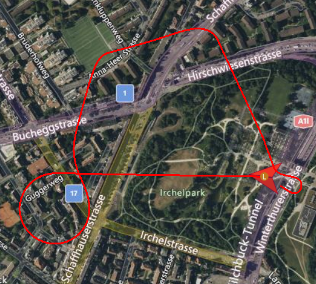

# ASTRON — Sabit Kanat Otonom Görev (PX4 + MAVSDK)

PX4 SITL ve Gazebo üzerinde simüle edilen sabit kanatlı bir İHA (RC Cessna), QGroundControl'de planlanan görevi (Takeoff → Waypoint'ler → İniş deseni) otonom olarak uçar. Python + MAVSDK ile yazılan `mission_runner.py`, PX4'e bağlanır, gerekli kontrolleri yapar, aracı arm edip yüklü görevi başlatır ve uçuşu terminalde canlı telemetriyle takip eder.

**Hazırlayan:** Şevketcan Sezen

📹 **Uçuş videosu:** _(eklenecek)_

📄 [Teori dokümanı](docs/teori.md) · [Teknik rapor](docs/rapor.md)



---

## İçerik

```
src/mission_runner.py   Görevi doğrulayan, başlatan ve izleyen ana kod (bonus telemetri dahil)
src/connect_test.py     Sadece bağlantı ve sağlık durumunu test eden kısa kod
missions/rota_1.plan    QGroundControl'de hazırlanan uçuş rotası
docs/teori.md           PX4, SITL, Gazebo, QGC, MAVLink, MAVSDK
docs/rapor.md           Sistemin çalışma mantığı
docs/img/               Ekran görüntüleri
```

## Test edilen ortam

| Bileşen | Sürüm |
|---|---|
| İşletim sistemi | Ubuntu 22.04.5 LTS |
| PX4-Autopilot | v1.14.3 |
| Simülatör | Gazebo Sim 7.9.0, model: `gz_rc_cessna` |
| Yer istasyonu | QGroundControl (AppImage) |
| Python | 3.10.12 |
| MAVSDK-Python | 3.17.4 (`mavsdk<4`) |

## Kurulum

### 1. PX4 SITL + Gazebo

```bash
git clone https://github.com/PX4/PX4-Autopilot.git --recursive
bash ./PX4-Autopilot/Tools/setup/ubuntu.sh
# Kurulum bitince bilgisayarı yeniden başlat
```

Ayrıntı: [PX4 Ubuntu geliştirme ortamı](https://docs.px4.io/main/en/dev_setup/dev_env_linux_ubuntu.html)

### 2. QGroundControl

[QGroundControl indirme ve kurulum](https://docs.qgroundcontrol.com/master/en/qgc-user-guide/getting_started/download_and_install.html) sayfasındaki Ubuntu adımlarını uygula, ardından:

```bash
chmod +x QGroundControl.AppImage
./QGroundControl.AppImage
```

### 3. MAVSDK-Python

```bash
pip install --user -r requirements.txt
```

> MAVSDK 4.x sürümünde Python arayüzü (API) değişti. Bu projedeki kod 3.x arayüzüyle yazıldığı için `requirements.txt` içinde `mavsdk<4` sabitlenmiştir.

## Kullanım

**1. Simülasyonu başlat (Terminal 1)**
```bash
cd ~/PX4-Autopilot
make px4_sitl gz_rc_cessna
```
Terminalde `pxh>` görününce PX4 hazırdır.

**2. İniş ayarları (sadece ilk seferde, `pxh>` satırına)**
```
param set FW_LND_USETER 0
param set FW_LND_ABORT 0
```
Simülasyondaki modelde mesafe sensörü olmadığı için PX4'ün inişte zemin ölçümü aramaması ve bu yüzden inişi iptal etmemesi sağlanır. Ayarlar SITL'de kalıcı olarak saklanır.

**3. QGroundControl**
1. QGC'yi aç; simülasyona otomatik bağlanır (UDP 14550).
2. *Plan* ekranında *File → Open* ile `missions/rota_1.plan` dosyasını aç.
3. *Upload* ile görevi PX4'e yükle.
4. Uçuşu izlemek için *Fly* ekranına geç.

**4. Görevi başlat ve izle (Terminal 2)**
```bash
cd astron-fw-mission
python3 src/mission_runner.py
```

Script sırasıyla:
1. PX4'e bağlanır (UDP 14540).
2. Sağlık kontrolü yapar ve GPS, home ve arm izni hazır olana kadar bekler.
3. PX4'teki yüklü görevi okur ve Takeoff ile Land öğelerini doğrular.
4. Aracı arm eder ve görevi başlatır.
5. Waypoint ilerlemesini ve telemetriyi her saniye yazdırır.
6. İniş ve disarm olunca kapanır.

Sadece bağlantıyı test etmek için: `python3 src/connect_test.py`

## Örnek terminal çıktısı (kısaltılmış)

```
[1/6] PX4'e baglaniliyor...
      Baglandi.
[2/6] Saglik kontrolu (GPS, home konumu, arm edilebilirlik)...
      Arac hazir.
[3/6] PX4'teki yuklu gorev okunuyor...
      #00 NAV_TAKEOFF            alt=   50.0 m
      #01 NAV_WAYPOINT           alt=   50.0 m
      #02 NAV_WAYPOINT           alt=   50.0 m
      #03 DO_LAND_START          alt=    0.0 m
      #04 CMD_206                alt=    0.0 m
      #05 CMD_2001               alt=    nan m
      #06 CMD_2501               alt=    nan m
      #07 NAV_LOITER_TO_ALT      alt=   40.0 m
      #08 NAV_LAND               alt=    0.0 m
[4/6] Arm ediliyor ve gorev baslatiliyor...
[5/6] Gorev izleniyor...
WP   0/9 | MISSION      | TAKING_OFF | arm=E | lat 47.397753 lon 8.545981 | irtifa 5.3m  | yer hizi 12.5m/s | hava hizi 13.7m/s | tirmanma 5.3m/s
WP   1/9 | MISSION      | IN_AIR     | arm=E | lat 47.399618 lon 8.545061 | irtifa 51.3m | yer hizi 12.3m/s | hava hizi 12.0m/s | tirmanma 0.0m/s
WP   8/9 | MISSION      | LANDING    | arm=E | lat 47.397763 lon 8.542338 | irtifa 24.8m | yer hizi 11.1m/s | hava hizi 10.8m/s | tirmanma -1.2m/s
WP   9/9 | MISSION      | ON_GROUND  | arm=E | lat 47.397699 lon 8.545847 | irtifa 0.1m  | yer hizi 1.8m/s  | hava hizi 1.6m/s  | tirmanma -0.0m/s
[6/6] Inis tamam. Disarm bekleniyor...
WP   0/9 | MISSION      | ON_GROUND  | arm=H | lat 47.397682 lon 8.545887 | irtifa 0.0m  | ...
Gorev tamamlandi.
```

Tam çıktı: [kalkış](docs/img/terminal_kalkis.png) · [iniş](docs/img/terminal_inis.png)

## Karşılaşılan sorunlar ve çözümler

| Sorun | Neden | Çözüm |
|---|---|---|
| `ninja: error: unknown target 'gz_advanced_plane'` | Bu model PX4 v1.14.3'te tanımlı değil. | `ls ROMFS/px4fmu_common/init.d-posix/airframes \| grep gz_` ile mevcut modeller listelendi, sabit kanat olarak `gz_rc_cessna` kullanıldı. |
| `PX4 server already running for instance 0` | Önceki denemeden kalan PX4 süreci arka planda açıktı. | `pkill -x px4` ve `pkill -f "gz sim"` ile kapatılıp yeniden başlatıldı. Simülasyon `pxh>` satırında `shutdown` ile kapatılmalı. |
| `TypeError: System is not constructed directly...` | MAVSDK 4.x'te Python arayüzü değişti. | `pip install --user "mavsdk<4"` ile 3.17.4 kuruldu. |
| İlk bağlantıda `GPS: False`, `Arm edilebilir: False` | Simülasyon yeni açıldığında PX4'ün konum tahmini henüz oturmamıştı. | Birkaç saniye sonra değerler `True` oldu. `mission_runner.py` bu yüzden değerler hazır olana kadar bekler. |
| `Landing aborted: terrain measurement not found` ([görüntü](docs/img/inis_iptal_hatasi.png)) | PX4 sabit kanat inişinde zemin mesafesini ölçmek istiyor; simülasyondaki modelde mesafe sensörü yok. | `FW_LND_USETER = 0` ve `FW_LND_ABORT = 0` yapıldı. |

## Kaynaklar

- İHA Masterclass, Enes Durudeniz (Bölüm 0–16) ve [IHA_Masterclass deposu](https://github.com/Enesdrdnz/IHA_Masterclass)
- [PX4 dokümantasyonu](https://docs.px4.io/main/en/)
- [MAVSDK-Python](https://mavsdk.mavlink.io/main/en/python/)
