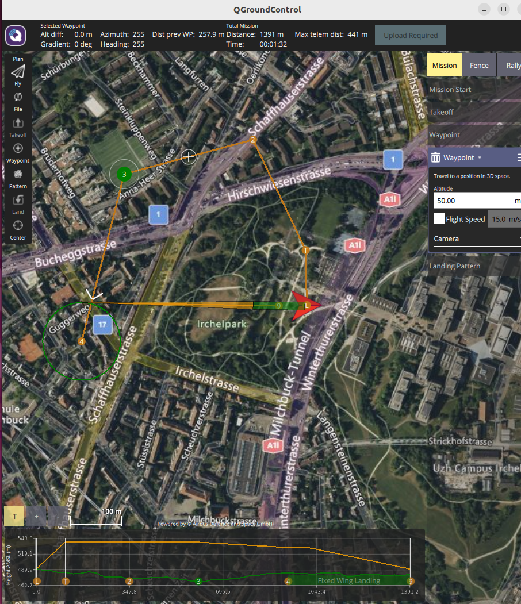
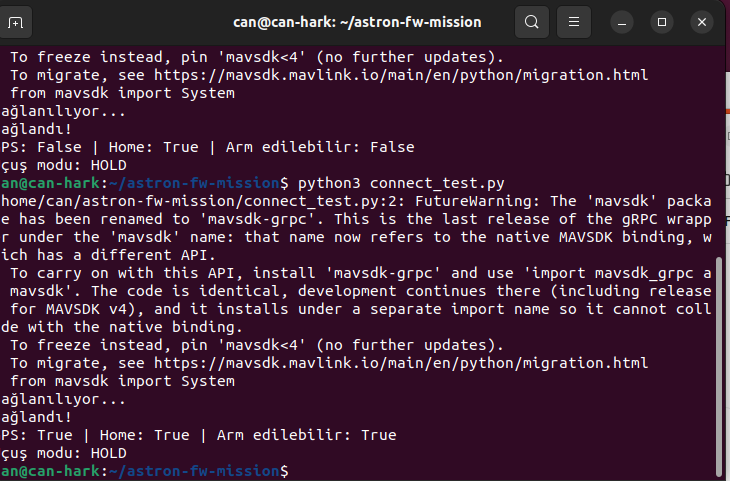
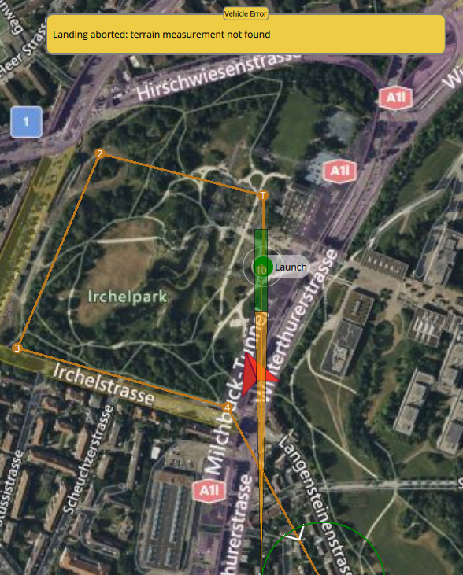
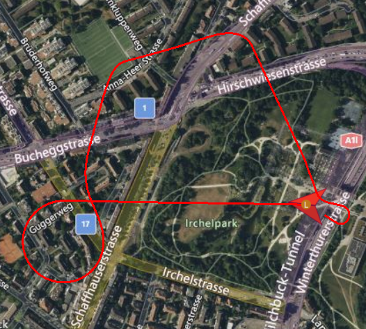

# Teknik Rapor: Sabit Kanat Otonom Görev

**Hazırlayan:** Şevketcan Sezen

## 1. Amaç

Bu çalışmada bilgisayarda simüle edilen sabit kanatlı bir İHA'nın, QGroundControl'de çizdiğim bir rotayı kimse kumanda etmeden uçmasını sağladım. Rotayı QGroundControl ile PX4'e yükledim. Python ve MAVSDK ile yazılan kod PX4'e bağlanıp kontrolleri yaptı, uçağı arm etti, görevi başlattı ve uçuşu terminalde canlı olarak takip etti.

## 2. Sistem nasıl çalışıyor?

Bütün parçalar aynı bilgisayarda, ayrı programlar olarak çalıştı:

```
┌──────────────────────── Bilgisayar (SITL) ─────────────────────────┐
│                                                                    │
│  Gazebo  ⇄  PX4 SITL  ── MAVLink / UDP 14550 ──  QGroundControl    │
│ (sanal       (pilot)                            (rota çizme,       │
│  dünya)         │                                 yükleme, izleme) │
│                 └──── MAVLink / UDP 14540 ──  mission_runner.py    │
│                                                 (başlatma, izleme) │
└────────────────────────────────────────────────────────────────────┘
```

| Parça | Bu projedeki görevi |
|---|---|
| **Gazebo** | Sanal uçağın ve dünyanın bulunduğu ortam. Sensör verilerini üretip PX4'e gönderdi. |
| **PX4 SITL** | Uçağın beyni. Yüklediğim rotayı hafızasında tuttu ve uçağı kendisi uçurdu. |
| **QGroundControl** | Rotayı çizdiğim, PX4'e yüklediğim ve uçuşu haritada izlediğim program |
| **mission_runner.py** | PX4'e "başla" diyen ve uçuşu izleyen Python kodu |

QGroundControl ve Python kodu PX4 ile aynı dilde (MAVLink) ama farklı kapılardan (UDP 14550 ve 14540) konuştuğu için ikisi aynı anda bağlı kalabildi.

## 3. Yaptıklarım, adım adım

### Adım 1: Simülasyonu başlattım

Ubuntu 22.04 üzerinde kurulu PX4 v1.14.3 ile sabit kanatlı uçağı başlatmaya çalıştım. İlk denediğim `gz_advanced_plane` modeli bu PX4 sürümünde yoktu (`unknown target` hatası). PX4'ün tanıdığı Gazebo araçlarını listeledim ve sabit kanatlı olan `gz_rc_cessna` modelini seçtim:

```bash
make px4_sitl gz_rc_cessna
```

Bir denemede `PX4 server already running` hatası aldım; önceki denemeden kalan PX4 arka planda açık kalmıştı. `pkill -x px4` ile kapatıp yeniden başlattım.

Simülasyon açılınca PX4 terminalinde `No connection to the ground control station` uyarıları vardı. PX4, yer istasyonu bağlı olmadan uçuşa izin vermiyordu.

### Adım 2: QGroundControl'ü bağladım

QGroundControl'ü açınca simülasyona kendiliğinden bağlandı. PX4 terminalindeki uyarılar kesildi ve `Ready for takeoff!` mesajı geldi.

### Adım 3: Rotayı çizdim



| Öğe | Ayar |
|---|---|
| Kalkış | 50 m |
| Ara noktalar | 2 adet, 50 m irtifada, aralarında yaklaşık 250 m |
| İniş deseni | Alçalma noktasında 75 m yarıçaplı daire çizerek 40 m'ye inme, sonra 6° açıyla süzülerek kalkış noktasının yanına iniş |
| Toplam | 1391 m, yaklaşık 1,5 dakika |

**Neden böyle çizdim:**
- **Noktalar arası uzun mesafe:** Sabit kanatlı uçak havada duramaz ve keskin dönemez. Noktaları yakın koysaydım uçak onları kaçırıp etraflarında dönmek zorunda kalacaktı.
- **İniş deseni:** Sabit kanatlı uçak dikey inemez. Önce daire çizerek alçalıyor, sonra düz bir hat boyunca süzülerek iniyor.
- **Yaklaşma mesafesi:** QGroundControl, 40 m yükseklik ve 6° açı için yaklaşma mesafesini 380 m olarak hesapladı. Bu, mesafe = 40 / tan(6°) ≈ 380 m hesabının sonucu.

### Adım 4: Rotayı kaydettim ve PX4'e yükledim

Rotayı `rota_1.plan` dosyası olarak kaydettim ve **Upload** ile PX4'e gönderdim. Dosyayı kaydetmek rotayı sadece bilgisayarda saklıyor; Upload'a basınca rota PX4'ün hafızasına geçiyor.

### Adım 5: Python ile bağlandım

Önce sadece bağlantıyı test eden kısa bir kod (`connect_test.py`) çalıştırdım. Bilgisayarımda MAVSDK'nın 4.1.0 sürümü kuruluydu ve kod `TypeError` hatası verdi, çünkü 4. sürümde kullanım şekli değişmiş. `pip install --user "mavsdk<4"` ile 3.17.4 sürümünü kurunca bağlantı çalıştı.



İlk denemede GPS ve arm izni `False` çıktı, birkaç saniye sonraki denemede ikisi de `True` oldu. Bundan şunu öğrendim: Simülasyon yeni açıldığında PX4 konumunu henüz hesaplamış olmuyor. Bu yüzden asıl kod, değerler hazır olana kadar bekleyecek şekilde yazıldı.

### Adım 6: Uçağı Python ile uçurdum

`mission_runner.py`'yi çalıştırdım. İlk uçuşta uçak rotayı tamamladı ama inişte `Landing aborted: terrain measurement not found` hatası verip inişi iptal etti.



Bunun sebebi şuydu: PX4, sabit kanat inerken yere olan mesafeyi bir mesafe sensörüyle ölçmek istiyor, simülasyondaki uçakta ise bu sensör yok. PX4 terminalinde iki ayarı değiştirdim:

```
param set FW_LND_USETER 0
param set FW_LND_ABORT 0
```

Birinci ayar "inişte mesafe sensörünü kullanma", ikincisi "sensör yok diye inişi iptal etme" anlamına geliyor. Bu ayarlardan sonraki uçuşta uçak kalktı, rotayı uçtu, daire çizerek alçaldı, süzülerek indi ve motorlarını kendisi kilitledi.

## 4. Python kodunun görevi

Kod uçağı kendisi uçurmuyor. Sırasıyla şunları yapıyor:

| Adım | Ne yapıyor |
|---|---|
| 1 | PX4'e bağlanıyor (UDP 14540) |
| 2 | PX4'e "hazır mısın?" diye soruyor; GPS, kalkış noktası ve arm izni hazır olana kadar bekliyor |
| 3 | PX4'ün hafızasındaki rotayı okuyup ekrana yazıyor; kalkış ve iniş komutlarının olduğunu kontrol ediyor |
| 4 | Uçağı arm ediyor ve "rotaya başla" diyor |
| 5 | Uçuş boyunca her saniye konum, irtifa, hız ve uçuş durumunu yazıyor |
| 6 | Uçak inip motorlar kilitlenince kapanıyor |

Rotayı uygulayan PX4'ün kendisi. Rota PX4'ün hafızasında olduğu için kodun görevi başlatmak ve izlemek.

**Kodda dikkatimi çeken bir nokta:** QGroundControl'de 4 öğe çizmiştim, ama kod PX4'ün hafızasından **9 satır** okudu:

| # | Satır | Nereden geldi |
|---|---|---|
| 00 | NAV_TAKEOFF | Kalkış |
| 01–02 | NAV_WAYPOINT | 2 ara nokta |
| 03 | DO_LAND_START | İniş deseni: inişin başladığı yer |
| 04–06 | CMD_206, 2001, 2501 | İniş deseni: fotoğraf ve video çekimini durdurma |
| 07 | NAV_LOITER_TO_ALT | İniş deseni: daire çizerek alçalma |
| 08 | NAV_LAND | İniş deseni: süzülerek iniş |

Tek bir "Land" tıklaması arka planda 6 satır üretmiş. Kodda MAVSDK'nın `mission_raw` bölümünün kullanılmasının sebebi de bu: Bu satırları bozmadan okuyabiliyor.

## 5. Telemetri (bonus)

Uçuş sırasında terminalde her saniye şu bilgiler yazdı:
- Görev ilerlemesi (WP 0/9 … 9/9)
- Uçuş modu (HOLD → MISSION)
- Uçuş durumu (ON_GROUND → TAKING_OFF → IN_AIR → LANDING → ON_GROUND)
- Arm durumu (arm=H → arm=E → arm=H)
- Enlem, boylam, irtifa
- Yer hızı, hava hızı, tırmanma hızı
- Batarya

Terminal çıktısı: [kalkış](img/terminal_kalkis.png) · [iniş](img/terminal_inis.png)

## 6. Sonuç



- Uçağın izi çizdiğim rotayla örtüştü: dörtgen rota, batıdaki alçalma dairesi ve kalkış noktasına doğru düz iniş hattı.
- Seyir sırasında yer hızı yaklaşık 11–15 m/s, irtifa 50 m civarındaydı.
- İnişte terminalde tırmanma hızı sürekli yaklaşık **-1,1 m/s**, yer hızı **10,7 m/s** idi. Bu, 6°'lik süzülme açısıyla uyumlu: 10,7 × tan(6°) ≈ 1,1 m/s. Yani uçak süzülme hattını hesaplandığı gibi uçtu.

## 7. Karşılaştığım sorunlar

| Sorun | Çözüm |
|---|---|
| `gz_advanced_plane` bu PX4 sürümünde yok | `gz_rc_cessna` kullandım |
| Arka planda açık kalan PX4 (`already running`) | `pkill -x px4` ile kapattım |
| MAVSDK 4.x'te kullanım şekli değişmiş (`TypeError`) | `mavsdk<4` sürümünü kurdum |
| İlk bağlantıda GPS ve arm izni `False` | Birkaç saniye bekleyince düzeldi; kod hazır olana kadar bekliyor |
| İniş "terrain measurement not found" hatasıyla iptal edildi | `FW_LND_USETER` ve `FW_LND_ABORT` ayarlarını 0 yaptım |
